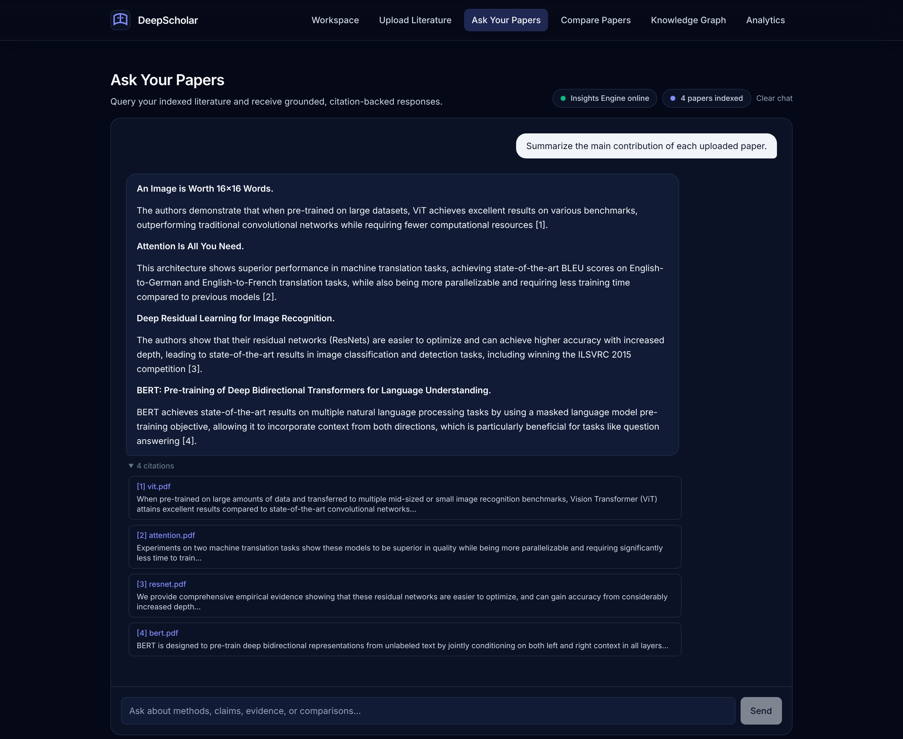
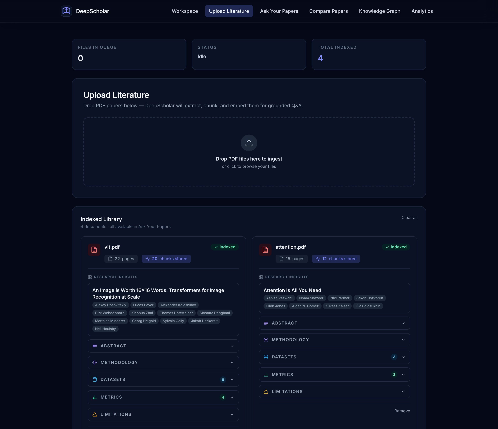
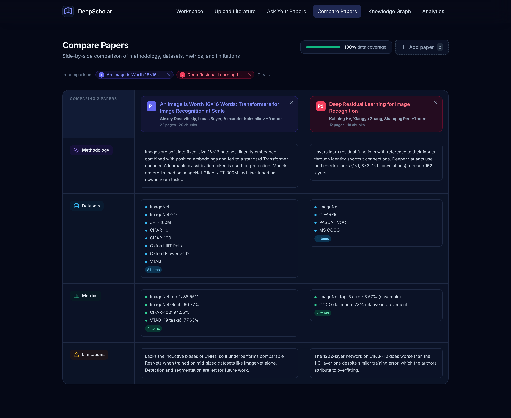
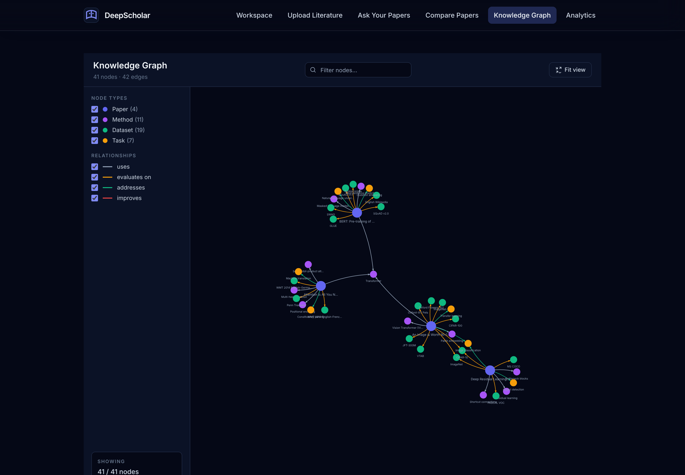
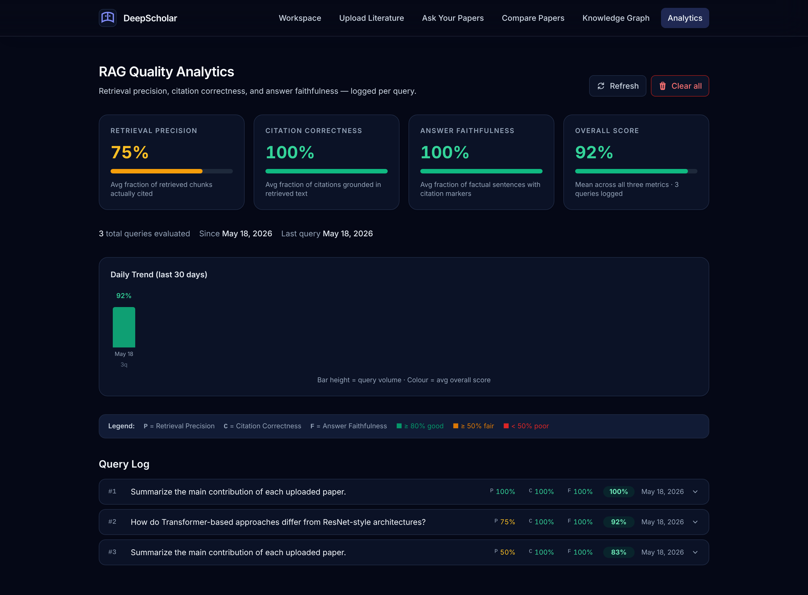

# DeepScholar

<p>
  <a href="https://github.com/egehank1/deepscholar/actions/workflows/ci.yml"></a>
  
  
  
  
  
  
</p>

Ask questions about a pile of research papers and get answers you can actually check. Every sentence points back to the passage it came from, and anything the model can't back up with a citation gets cut before you see it.

Runs fully local with [Ollama](https://ollama.com) (no API key, your PDFs never leave your machine), or with OpenAI if you prefer.

<p align="center">
  
</p>

<p align="center">
  <a href="#quick-start">Quick start</a> ·
  <a href="#what-you-get">What you get</a> ·
  <a href="#how-retrieval-works">How retrieval works</a> ·
  <a href="#configuration">Configuration</a> ·
  <a href="#api">API</a>
</p>

## Why I built this

I kept misattributing quotes. I'd write a paragraph comparing two papers and realise later that the line I used came from a third one. Generic chatbots weren't any better, they'd happily invent a citation that looked right.

So the rule for DeepScholar is simple: the model only gets to say what's in the retrieved passages, with a `[N]` marker on every claim. A post-processing pass strips uncited sentences, and the citation list is rebuilt from the markers the answer actually uses, so the two can't drift apart. The longer story is in [docs/writeup.md](docs/writeup.md).

## Quick start

You need Docker, Python 3.11+, Node 18+ and Ollama.

```bash
git clone https://github.com/egehank1/deepscholar.git
cd deepscholar

# 1. models (one-time, ~5 GB)
ollama pull qwen2.5:7b
ollama pull nomic-embed-text

# 2. database (Postgres + pgvector)
docker compose up -d

# 3. backend
cd backend
python -m venv .venv && source .venv/bin/activate   # Windows: .venv\Scripts\activate
pip install -r requirements.txt
cp .env.example .env
uvicorn app.main:app --reload

# 4. frontend (new terminal)
cd frontend
npm install
npm run dev
```

Open http://localhost:3000, go to **Upload**, drop in a few PDFs and start asking.

Tables are created automatically on first start. `http://localhost:8000/health` tells you which models are in use and whether the database is reachable.

**One Ollama setting matters:** Ollama's default context window can be as small as 4k tokens, and a multi-paper question sends a lot more than that. Start Ollama with a bigger one or answers get silently truncated:

```bash
OLLAMA_CONTEXT_LENGTH=16384 ollama serve
```

Prefer containers for everything? `docker compose --profile app up -d --build` runs the backend and frontend too (Ollama stays on the host so it can use your GPU).

### Using OpenAI instead

In `backend/.env`:

```dotenv
LLM_PROVIDER=openai
OPENAI_API_KEY=sk-...
```

That gives you `gpt-4o-mini` and `text-embedding-3-large`. Any other OpenAI-compatible server (LM Studio, vLLM, llama.cpp) works too via `OPENAI_BASE_URL`.

## What you get

**Upload.** Drop in one or many PDFs. Text is extracted with PyMuPDF, split into overlapping chunks that end on sentence boundaries, embedded and stored in pgvector. At the same time the model pulls out title, authors, abstract, methodology, datasets, metrics, tasks, prior work and limitations. Fields it can't find stay empty instead of being made up. Uploading the same file again replaces it.

<p align="center">
  
</p>

**Chat.** Ask in plain language. Questions like "compare the methods of each paper" are detected and retrieved per paper, so one paper with lots of overlapping vocabulary can't crowd out the others.

**Compare.** Pick a few papers and see methodology, datasets, metrics and limitations side by side.

<p align="center">
  
</p>

**Knowledge graph.** Papers, methods, datasets and tasks as nodes, linked by `uses`, `evaluates_on`, `addresses` and `improves`. Useful for spotting which of your papers share a benchmark.

<p align="center">
  
</p>

**Analytics.** Every answer is scored and logged, so you can see when retrieval gets worse:

- *retrieval precision*: how many retrieved chunks ended up cited
- *citation correctness*: whether cited text is really in the chunk it's attributed to
- *answer faithfulness*: share of factual sentences that carry a citation

These are cheap heuristics, not an LLM judge. They catch regressions well, they don't prove an answer is correct.

<p align="center">
  
</p>

## How retrieval works

Every step here is a fix for something that went wrong during development.

1. **Hybrid search.** Vector search misses exact names (a dataset, a metric); keyword search misses paraphrases. Both run and get merged with Reciprocal Rank Fusion, `score = Σ 1 / (60 + rank)`. No score normalisation needed. → `services/vector_store.py`
2. **Per-paper retrieval for multi-paper questions.** A cheap regex classifier spots "compare / each paper / summarise all" style questions and pulls top-k from every paper separately. → `api/chat.py`
3. **BM25 rerank.** The candidate pool is rescored with Okapi BM25 and blended `0.6 × bm25 + 0.4 × vector`. Leaning lexical works better for grounded Q&A, where the right chunk usually contains the query terms. Plain Python, no extra dependency. → `services/reranker.py`
4. **Coverage check.** After reranking, any paper in scope with zero passages gets its single best match added back.
5. **Grounded generation.** JSON mode, temperature 0, and a system prompt that only allows answers from the given passages, with one cited paragraph per paper for comparisons.
6. **Citation reconciliation.** Models sometimes cite `[7]` in the text but list something else in their citations array. The parser ignores that array, rebuilds citations from the markers actually used and renumbers them `[1]`, `[2]`, … → `services/llm.py`
7. **Strip uncited claims.** Any factual-looking sentence without a marker is removed.
8. **Score it.** The three metrics above are computed and stored for the analytics page. → `services/evaluation.py`

```
PDF ─► text ─► chunks ─► embeddings ─► pgvector
                 └─► structured extraction ─► paper_extractions ─► graph / compare

question ─► embed ─► vector + keyword search ─► RRF ─► BM25 rerank
         ─► coverage check ─► LLM (JSON) ─► reconcile citations ─► strip uncited ─► score
```

## Configuration

All settings live in `backend/.env` (see [`.env.example`](backend/.env.example)).

| Variable | Default | |
|---|---|---|
| `LLM_PROVIDER` | `openai` (`.env.example` sets `ollama`) | `ollama` or `openai` |
| `CHAT_MODEL` | `qwen2.5:7b` / `gpt-4o-mini` | any chat model your provider has |
| `EMBEDDING_MODEL` | `nomic-embed-text` / `text-embedding-3-large` | |
| `VECTOR_DIMENSIONS` | 768 / 3072 | filled in for known models, set it for others |
| `DATABASE_URL` | – | any Postgres with pgvector; Supabase works (`SUPABASE_DB_URL` is still read) |
| `RESET_ON_STARTUP` | `false` | wipe papers and logs on every restart |
| `OLLAMA_BASE_URL` | `http://localhost:11434/v1` | |
| `OPENAI_BASE_URL` | – | for other OpenAI-compatible servers |

**Switching embedding models** changes the vector size. The backend notices on startup and tells you. Drop the `documents` table (or the whole volume, `docker compose down -v`) and re-upload.

**About 3072-dim vectors:** pgvector can only index up to 2000 dimensions, so with `text-embedding-3-large` at full size search is an exact scan. That's fine for a personal library. For bigger ones set `VECTOR_DIMENSIONS=1536`, and an HNSW index gets created.

## API

Interactive docs at http://localhost:8000/docs.

| Method | Path | |
|---|---|---|
| POST | `/upload` | upload PDFs (multipart), extract, embed, store |
| POST | `/chat` | `{"question": "...", "sources": []}` → answer + citations + retrieval stats |
| GET | `/documents` | indexed filenames |
| DELETE | `/documents/{source}` | remove a paper |
| GET | `/api/knowledge-graph` | nodes and typed edges |
| GET | `/api/evaluation/logs` | per-question quality log |
| GET | `/api/evaluation/analytics` | averages and 30-day trend |
| GET | `/health` | status, models in use, database check |

```bash
curl -X POST http://localhost:8000/chat \
  -H "Content-Type: application/json" \
  -d '{"question": "Compare the methodologies of each paper.", "sources": []}'
```

## Project layout

```
backend/
  app/api/          FastAPI routes (upload, chat, documents, graph, evaluation)
  app/services/     chunking, embeddings, extraction, llm, reranker, evaluation, vector_store
  app/core/         settings
  tests/            pytest
frontend/
  app/              Next.js pages: upload, chat, compare, graph, analytics
  components/ lib/ store/
docker-compose.yml  Postgres + pgvector (and optionally the app)
```

Run the backend tests with `pip install -r requirements-dev.txt && pytest`.

## Known limitations

- Scanned PDFs without a text layer come out empty (no OCR yet).
- Small local models follow the citation rules less reliably than `gpt-4o-mini`. Extraction quality also drops, especially for the knowledge graph. 7B+ models are the practical minimum.
- One shared database connection. Fine locally, not for multiple workers.
- No auth. Don't expose it to the internet as is.

## Roadmap

- streaming answers
- follow-up questions that reuse the previous turn's passages
- optional cross-encoder rerank
- OCR fallback for scanned papers

Issues and PRs are welcome. If you try it with a local model, I'd like to hear which one worked best for you.

## License

MIT, see [LICENSE](LICENSE).

Reciprocal Rank Fusion is from Cormack, Clarke & Büttcher (2009). BM25 follows Robertson & Zaragoza, *The Probabilistic Relevance Framework: BM25 and Beyond* (2009).
